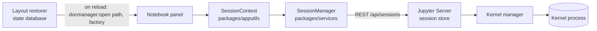
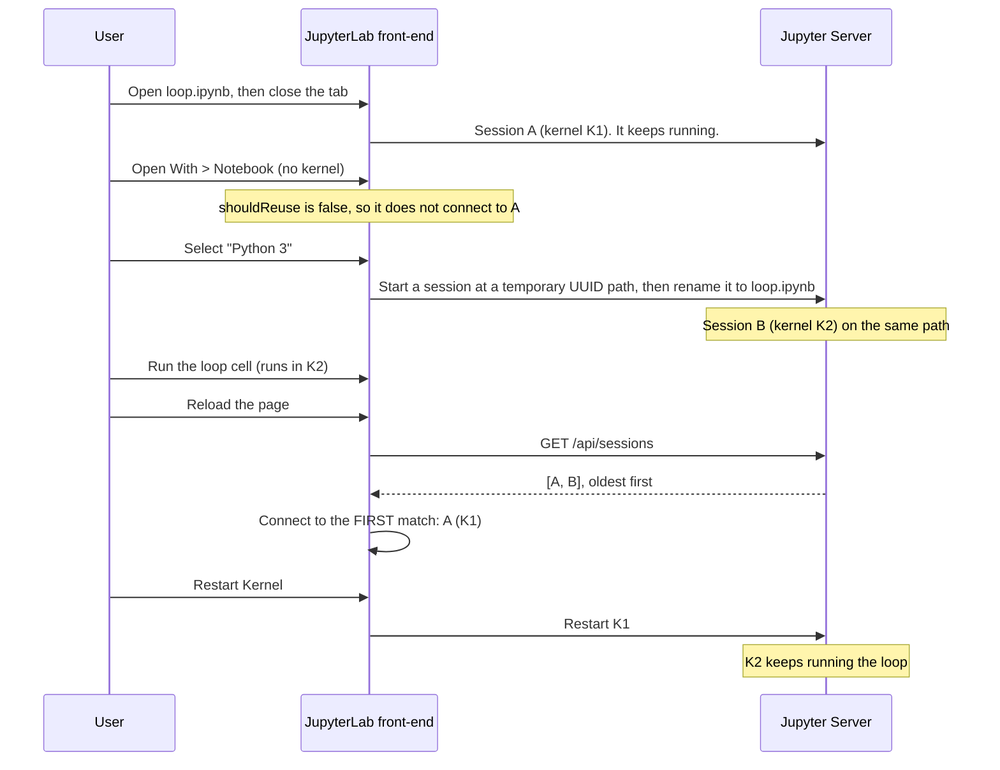
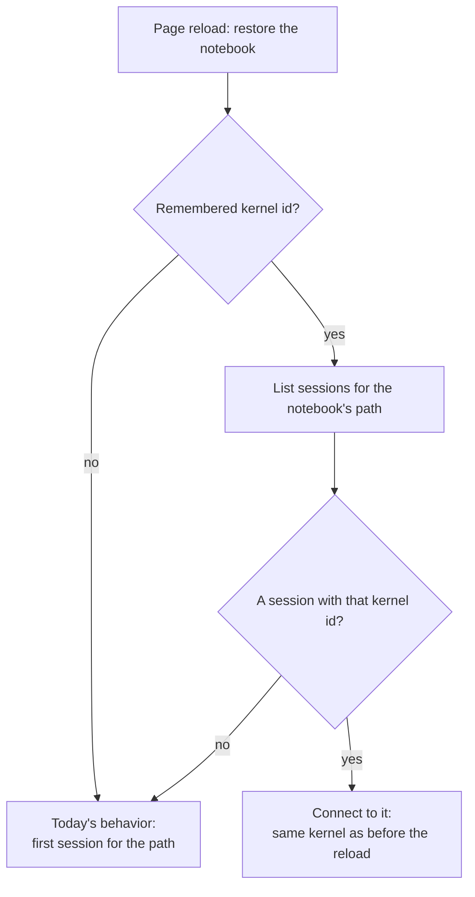

# MachZero 2026 — Team Notes for jupyterlab/jupyterlab#20372

> **Issue:** [Reloading the page can connect a notebook to another kernel, so Restart Kernel does not stop its running code](https://github.com/jupyterlab/jupyterlab/issues/20372)
> **Team fork:** [Pradhyut21/jupyterlab](https://github.com/Pradhyut21/jupyterlab), the single shared fork for the team. Everyone pushes here until Round 3 ends.
> **Demo:** [`machzero/jupyterlab-20372-demo/`](machzero/jupyterlab-20372-demo/)

This file records our whole process: how we chose the issue, what we learned about JupyterLab, our plan, and every failure and success along the way. It is updated at the end of each round.

---

## Contents

1. [Status at a glance](#1-status-at-a-glance)
2. [Round 1: choosing a repository and an issue](#2-round-1-choosing-a-repository-and-an-issue)
3. [The issue in plain words](#3-the-issue-in-plain-words)
4. [Round 2: understanding JupyterLab](#4-round-2-understanding-jupyterlab)
5. [Root cause](#5-root-cause)
6. [Existing work: PR #20426](#6-existing-work-pr-20426)
7. [Our proposed solution](#7-our-proposed-solution)
8. [Testing strategy](#8-testing-strategy)
9. [Validation approach and demo results](#9-validation-approach-and-demo-results)
10. [Failures and challenges](#10-failures-and-challenges)
11. [Successes so far](#11-successes-so-far)
12. [Plan for Round 3](#12-plan-for-round-3)
13. [Contribution rules we follow](#13-contribution-rules-we-follow)
14. [AI usage](#14-ai-usage)
15. [Timeline](#15-timeline)

---

## 1. Status at a glance

| Item | Status |
|---|---|
| Repository and issue selected | ✅ jupyterlab/jupyterlab#20372 |
| Fork created and cloned | ✅ `Pradhyut21/jupyterlab`, in sync with upstream `main` at `1c917ab` (6 Nov 2026) |
| Bug reproduced | ✅ Against a real Jupyter Server, in an executable notebook (section 9) |
| Root cause identified | ✅ Section 5, with source references |
| Existing pull request studied | ✅ PR #20426 (section 6) |
| Solution designed | ✅ Session identity affinity (section 7). **Not yet implemented in JupyterLab.** |
| Testing and validation plan | ✅ Sections 8 and 9 |
| Implementation, tests, pull request | ⏳ Round 3 |

---

## 2. Round 1: choosing a repository and an issue

### 2.1 What we looked for

| Criterion | Why it matters |
|---|---|
| Real user impact | A fix users feel, not a cosmetic change |
| Reproducible and testable | We must show the bug and prove the fix with a test |
| Feasible in the event timeline | Days, not weeks |
| Low duplicate-work risk | No maintainer already doing it, no finished competing fix |
| Contribution rules we can follow | Including the project's policy on AI-assisted contributions |

### 2.2 First attempt: astral-sh/uv#23073, dropped after research (NO-GO)

**The issue:** `uv lock --locked` and `uv sync --locked` accept a `uv.lock` whose locked versions break the version rules declared in `pyproject.toml`, if the declarations recorded in the lockfile were edited to match.

**Why it first looked good:** a real correctness bug, labeled `bug`, in a popular Rust project.

**What our research found:**

| Finding | Evidence |
|---|---|
| A uv maintainer already has a draft pull request for exactly this check | [astral-sh/uv#18566](https://github.com/astral-sh/uv/pull/18566), open since March 2026 |
| The maintainers' related lock-safety work names that draft as the place where this check lives | [astral-sh/uv-dev#96](https://github.com/astral-sh/uv-dev/pull/96) and [#100](https://github.com/astral-sh/uv-dev/pull/100): "uv#18566 separately checks that locked versions satisfy requirement specifiers" |
| uv requires checking in with maintainers before working on issues not labeled `help wanted` | uv `CONTRIBUTING.md`, "Finding ways to help" |
| uv's AI policy forbids AI-written comments to maintainers and autonomous-agent pull requests | [Astral AI policy](https://github.com/astral-sh/.github/blob/main/AI_POLICY.md) |
| A competing pull request for the same issue was closed under that policy, and so were five other outside pull requests between 4 and 6 November | [astral-sh/uv#23109](https://github.com/astral-sh/uv/pull/23109), label `bot:ai-policy-close` |
| The code area is being redesigned by maintainers right now | A preview mode that rebuilds lockfile dependencies from scratch (`lock-without-metadata`), plus large refactors in Sep–Oct 2026 |

**Decision:** NO-GO. A pull request would duplicate active maintainer work and would very likely not be merged.

**Lesson learned:** look for maintainer drafts, including in the maintainers' own development repositories, *before* investing in a fix. "No pull request mentions this issue number" does not mean nobody is working on it.

### 2.3 Final choice: jupyterlab/jupyterlab#20372

| Criterion | Assessment |
|---|---|
| Impact | Restart Kernel silently fails to stop running code, and the notebook hides the switch. Users think they stopped a computation when they did not. |
| Reproducible | The issue gives exact steps, a two-cell notebook and a video. We reproduced it (section 9). |
| Credibility | Reported by JupyterLab maintainer `krassowski`, labeled `bug` |
| Testable | Jest tests already exist for this code: `packages/apputils/test/sessioncontext.spec.ts` |
| Competition | Several teams commented on the issue. PR [#20426](https://github.com/jupyterlab/jupyterlab/pull/20426) by another contributor fixes the reported steps. Our solution targets a case that PR states it leaves open (section 6), so it complements it instead of duplicating it. |
| Rules | JupyterLab welcomes AI-assisted contributions with disclosure (section 13) |

---

## 3. The issue in plain words

* A **kernel** is the Python process that runs a notebook's code.
* A **session** is the server's record that links a notebook file to a kernel.
* Since JupyterLab **4.6.0**, opening a notebook with **Open With → Notebook (no kernel)** and then selecting a kernel creates a **second session** for the same file.
* After a **page reload**, JupyterLab connects the notebook to the **first** session the server lists for that file, which is the **older** one.
* **Restart Kernel** then restarts that other kernel. The code the notebook started keeps running, and the toolbar still shows the same kernel name, so the user cannot tell.

---

## 4. Round 2: understanding JupyterLab

### 4.1 The repository

| Part | What it is |
|---|---|
| `packages/` | The TypeScript front-end, split into many packages (Yarn workspaces) |
| `packages/apputils` | Shared application utilities, including `SessionContext`, which owns "which session and kernel this document uses" |
| `packages/services` | Clients for the Jupyter Server REST API: sessions, kernels, contents |
| `packages/notebook-extension` | Wires notebooks into the app: menus, commands, layout restoration |
| `packages/docmanager-extension` | The `docmanager:open` command that opens documents, including restored ones |
| `galata/` | Browser tests (Playwright) |
| `testutils/` | Jest helpers (`@jupyterlab/testutils`) |
| Back-end | Jupyter Server (Python) stores sessions and starts kernels |

Tooling, from `AGENTS.md`: TypeScript, React 18, Lumino widgets, CodeMirror 6; Yarn through the `jlpm` wrapper; Jest for package tests and Galata for browser tests.

### 4.2 How a notebook gets its kernel



### 4.3 The code that matters

Line numbers are from commit [`29752fe`](https://github.com/jupyterlab/jupyterlab/tree/29752fe1f6f0950a387afbe941dce5dcfbd60c0a), which the issue cites.

| Code | What it does | Role in the bug |
|---|---|---|
| [`sessioncontext.tsx` L845-L868](https://github.com/jupyterlab/jupyterlab/blob/29752fe1f6f0950a387afbe941dce5dcfbd60c0a/packages/apputils/src/sessioncontext.tsx#L845-L868) `_initialize()` | When a document opens, and again after every reload, it connects to the **first** running session whose path matches | Picks the older session after a reload |
| [`sessioncontext.tsx` L972-L1007](https://github.com/jupyterlab/jupyterlab/blob/29752fe1f6f0950a387afbe941dce5dcfbd60c0a/packages/apputils/src/sessioncontext.tsx#L972-L1007) `_changeKernel()` | With no session, starts a new one under a temporary UUID path, then renames it to the notebook's path | Creates the second session on the same path |
| [`sessioncontext.tsx` L263-L309](https://github.com/jupyterlab/jupyterlab/blob/29752fe1f6f0950a387afbe941dce5dcfbd60c0a/packages/apputils/src/sessioncontext.tsx#L263-L309) `IKernelPreference` | Options for choosing a kernel, including `id`: "The id of an existing kernel" | The existing field our solution reuses |
| [`notebook-extension/src/index.ts` L1551-L1561](https://github.com/jupyterlab/jupyterlab/blob/29752fe1f6f0950a387afbe941dce5dcfbd60c0a/packages/notebook-extension/src/index.ts#L1551-L1561) | "Notebook (no kernel)" opens with `shouldStart: false, shouldReuse: false` | Skips the existing session, added in [#18856](https://github.com/jupyterlab/jupyterlab/pull/18856) |
| `notebook-extension/src/index.ts` L2468-L2473 (fork `main`) | After a reload, notebooks reopen with `docmanager:open` and only `{ path, factory }` | Which kernel the notebook used is not restored |
| `docmanager-extension/src/index.tsx` L826-L832 (fork `main`) | `docmanager:open` already accepts `kernel` and `kernelPreference` | Lets the restorer pass the kernel back |
| Jupyter Server `services/sessions/sessionmanager.py`, `list_sessions()` | Lists sessions with `SELECT * FROM session`, in creation order | "First" means "oldest" |
| Jupyter Server `services/sessions/handlers.py`, `SessionHandler.patch()` | Changing a session's kernel starts a new kernel and shuts down the old one | Explains a side effect of PR #20426 (section 6) |

The two Jupyter Server entries were read in `jupyter_server` 2.21.1.

---

## 5. Root cause



**The broken invariant:** after a reload, a notebook should be connected to the kernel it was using before the reload.

**Two causes work together:**
1. Selecting a kernel in a "Notebook (no kernel)" view creates a duplicate session.
2. A reload does not remember which session or kernel the notebook used, so it picks by path alone.

---

## 6. Existing work: PR #20426

[PR #20426](https://github.com/jupyterlab/jupyterlab/pull/20426), "Do not start a second session when selecting a kernel for a notebook opened without one", is open, by another contributor.

| | |
|---|---|
| **What it changes** | In `_changeKernel`, when `shouldReuse === false`, it refreshes the running sessions. If one exists for the path, it changes that session's kernel instead of starting a second session. |
| **Strengths** | Small and focused. It follows the fix suggested in the issue, includes a Jest test, and handles a session that disappears mid-request. |
| **Limitation (stated in the PR)** | "A notebook that already has two sessions from an earlier run still has to have one of them shut down." It does not change what a reload connects to. |
| **Side effect we observed** | Changing a session's kernel shuts down that session's previous kernel. If another tab is running code in that session, the code stops. Kernel → Change Kernel does the same thing today, so we do **not** call this a defect. We record it for maintainers. |

**Cause 1 is covered by PR #20426. Cause 2 is not.** That gap is where our contribution fits.

---

## 7. Our proposed solution

### 7.1 Idea: session identity affinity

> After a reload, a notebook reconnects to **the kernel it was using**, not just to the first session that shares its file path.

### 7.2 Design, built on existing JupyterLab pieces

1. **Remember.** The layout restorer already saves each open notebook's restore arguments (`{ path, factory }`). It would also save the id of the notebook's current kernel, and refresh it when the kernel changes.
2. **Restore.** On reload, `docmanager:open` receives that id. The command already accepts `kernel` and `kernelPreference` arguments, and `IKernelPreference.id` already exists.
3. **Select.** `SessionContext._initialize()` prefers the session **on the notebook's own path** whose kernel has that id.
4. **Fall back safely.** If no such session exists (kernel shut down, server restarted, stale id), it keeps today's behavior: the first session for the path.

No new settings, no new public API, no new storage.



### 7.3 Alternatives considered

| Option | Covers new duplicates | Covers existing duplicates | Complexity | Verdict |
|---|---|---|---|---|
| A. Reuse the path's session when selecting a kernel (PR #20426) | ✅ | ❌ | Low | Good. Already proposed by someone else. |
| B. Session identity affinity (ours) | ✅ after a reload | ✅ | Low–medium | Covers the remaining gap |
| C. Detect ambiguity: warn when several sessions share a path | ❌ (only warns) | ⚠️ (still guesses) | Low | Helps diagnosis, does not fix |
| D. A + B together | ✅ | ✅ | Medium | Most complete. B is designed to work with or without A. |

### 7.4 Edge cases

| Case | Expected behavior |
|---|---|
| Remembered kernel still running | Reconnect to it |
| Remembered kernel shut down, or server restarted | Fall back to today's behavior |
| Remembered id belongs to a session for another file | Ignored: only sessions on the notebook's own path qualify |
| Notebook renamed or moved | The server updates the session path on rename, and the restorer key is the path. Must be tested. |
| Notebook opened with "Notebook (no kernel)" | Unchanged: no kernel is connected or started |
| User explicitly selects another kernel | Unchanged: an explicit choice wins, and the new id is remembered |
| Two tabs on the same notebook | Each restores its own remembered kernel |

### 7.5 Open questions for maintainers

* Do they want kernel identity in the restoration data, or do they prefer fixing only how duplicates are created (PR #20426)?
* Does using `IKernelPreference.id` during `_initialize()` count as a behavior change that needs agreement on the issue first? `AGENTS.md` asks for agreement on behavior and API changes.

---

## 8. Testing strategy

Following `AGENTS.md`: Jest first, Galata only where a browser is needed. A bug-fix test must **fail on an assertion** without the fix, and the test is **committed before the fix**.

| # | Test | Type | Location | Fails on `main`? |
|---|---|---|---|---|
| 1 | Two sessions on the path. A context whose preference `id` is the second session's kernel connects to the second session on initialize. | Jest | `packages/apputils/test/sessioncontext.spec.ts`, in `describe('#initialize()')` | Yes: it connects to the first |
| 2 | The preferred id is not on the path: falls back to the first session for the path | Jest | same | No (guards against regressions) |
| 3 | The preferred id belongs to another path: ignored | Jest | same | No (safety) |
| 4 | `shouldReuse: false` with a preferred id: still connects to nothing | Jest | same | No (keeps "no kernel" semantics) |
| 5 | Restoration passes the kernel id through `docmanager:open` | Jest or Galata | notebook-extension / `galata/test/jupyterlab/` | Yes |
| 6 | The full reload scenario: reload, then Restart Kernel stops the notebook's loop | Galata (optional) | `galata/test/jupyterlab/` | Yes |

Commands, from `AGENTS.md`:

```bash
jlpm install && jlpm build                 # at the repository root
cd packages/apputils && jlpm build:test    # Jest loads the compiled lib/
jlpm test -- -t "initialize"               # focused run
jlpm eslint:base --config eslint.config.typecheck.mjs <changed files>
```

---

## 9. Validation approach and demo results

### 9.1 Executable demo

[`machzero/jupyterlab-20372-demo/session_identity_demo.ipynb`](machzero/jupyterlab-20372-demo/session_identity_demo.ipynb) starts a **real** Jupyter Server with real sessions, kernels and processes, and runs the issue's looping cell.

The JupyterLab front-end is not running. Each front-end step is a line-by-line Python transcription of the TypeScript linked in the notebook, and it sends the same REST requests. The proposal in this demo is modeled the same way: it is a design we demonstrated, **not yet code in JupyterLab**.

**Results** (Windows 11, Python 3.13.5, Jupyter Server 2.21.1, JupyterLab 4.6.5 packages; two full runs, same outcome):

| Behavior | Scenario | Sessions on the path | Same kernel after reload | Restart stopped the loop |
|---|---|---|---|---|
| `main` | the issue's steps | 2 | ❌ | ❌ **bug reproduced** |
| PR #20426 | the issue's steps | 1 | ✅ | ✅ |
| PR #20426 | two sessions already exist | 2 | ❌ | ❌ |
| **Our proposal** | two sessions already exist | 2 | ✅ | ✅ |
| Our proposal | remembered kernel gone, or for another file | – | falls back safely | – |

From the bug reproduction, matching the issue's own output:

```
this kernel: pid 22976
loop: pid 24560 at 1794049140.2
loop: pid 24560 at 1794049142.2   <- the timestamp still moves: the loop survived the restart
```

### 9.2 Validation plan for the real fix

1. Reproduce on `main` in the browser with the issue's steps (`machzero/jupyterlab-20372-demo/loop.ipynb`).
2. Red: the new Jest test fails on an assertion on `main`.
3. Green: it passes with the fix. Existing `sessioncontext.spec.ts` tests still pass.
4. Repeat the browser steps on our branch, with and without PR #20426's change, and record both.
5. Run lint and the type-aware ESLint config on the changed files.

---

## 10. Failures and challenges

An honest log, in the order things happened.

| # | What went wrong | Impact | What we did |
|---|---|---|---|
| 1 | Our first issue (uv#23073) was already being solved by a maintainer | Hours of research that did not become a PR | Dropped it (NO-GO), and kept the lesson: check for maintainer drafts first |
| 2 | The GitHub API allows only 60 unauthenticated requests per hour | Research was throttled | Used `git` and normal web pages instead of the API |
| 3 | The C: drive had less than 1 GB free. A Rust toolchain download started there automatically. | Risk of filling the system drive | Stopped it, removed only the partial files, and moved all toolchains, caches and temp folders to D: |
| 4 | The uv debug build failed after about 50 minutes (exit code 101) | No local uv binary | Not investigated, because we switched issues |
| 5 | Parallel research helpers failed twice, once from a TLS certificate error and once from a usage limit | Lost research time | Did the research directly instead |
| 6 | The first demo run used an older Jupyter from the user profile instead of the project environment | Demo crashed | Run everything with `.venv\Scripts\python.exe -m ...` |
| 7 | On Windows, a kernel client sometimes reported "kernel died" before the kernel's first heartbeat | False failure in the demo | Wait for the kernel's real reply instead of the heartbeat |
| 8 | An old "Python (Stable Diffusion)" kernel points to a deleted Anaconda install | Opening the wrong notebook failed to start a kernel | Documented: use "Python 3 (ipykernel)", and open only `session_identity_demo.ipynb` |
| 9 | Several teams target the same issue, and PR #20426 already exists | Duplicate-work risk | Focused on the case PR #20426 leaves open, so our work complements it |

---

## 11. Successes so far

* Picked an issue with real user impact, a clear invariant, and an existing test suite.
* Avoided a duplicate pull request on uv by researching maintainer activity first.
* Reproduced the bug against a real Jupyter Server, with evidence matching the issue's video.
* Found the exact lines responsible, in both JupyterLab and Jupyter Server.
* Measured the competing PR fairly: it fixes the reported steps, and we found the case it leaves open.
* Designed a fix that reuses existing JupyterLab pieces and always falls back to today's behavior.
* Built a repeatable demo that runs in about 80 seconds and cleans up after itself.

---

## 12. Plan for Round 3

| Step | Task | Done |
|---|---|---|
| 1 | Comment on #20372, in our own words, describing the case of existing duplicate sessions and the proposal; ask whether maintainers want it | ☐ |
| 2 | `jlpm install && jlpm build` in the fork | ☐ |
| 3 | Write Jest test 1; confirm it fails on an assertion; commit it alone | ☐ |
| 4 | Implement the selection change in `SessionContext._initialize()` | ☐ |
| 5 | Pass the kernel id through restoration (`notebook-extension` restorer → `docmanager:open`) | ☐ |
| 6 | Tests 2–5; rebuild and run the `sessioncontext` tests | ☐ |
| 7 | Browser check with the issue's steps; record before and after | ☐ |
| 8 | Lint: pre-commit plus `eslint.config.typecheck.mjs` | ☐ |
| 9 | Prepare the PR using `.github/pull_request_template.md`. Explain the difference from #20426 under References, and fill in AI usage. | ☐ |
| 10 | Update this file with results | ☐ |

**Fallback if maintainers prefer only PR #20426:** help review it, as `AGENTS.md` suggests. Test it in the browser, and offer our existing-duplicates scenario as an extra test case.

---

## 13. Contribution rules we follow

From the fork's `AGENTS.md` and `.github/pull_request_template.md`:

* AI-assisted contributions are welcome, and must be at least as good as what maintainers' own agents produce.
* Behavior or public API changes need a maintainer's agreement on the issue first.
* A second PR for an issue must differ in a way that matters, explained under "References".
* The test fails on an assertion without the fix, and is committed before the fix.
* Rebuild before testing (`jlpm build:test`); no new ESLint warnings; never skip pre-commit hooks.
* The PR title is written for users, with no `fix:` or `feat:` prefix. Every template heading is kept, with `None` where it does not apply.
* The "AI usage" section names every tool and model and its effort level. No "Generated with" footers.
* We do not post AI-written comments as our own; we write them ourselves.

---

## 14. AI usage

We used **Claude Code (Anthropic, Claude Opus 5.5)** as an assistant for repository research, the demo notebook and drafting this document. Every result reported here was produced by commands run on our machine, and the team reviews everything before it is published. Any pull request will disclose AI use in its "AI usage" section, as the template requires.

---

## 15. Timeline

| When | What |
|---|---|
| 7 Nov 2026, morning | Round 1 starts. Research on astral-sh/uv#23073. |
| 7 Nov, midday | Maintainer draft found for uv#23073: NO-GO. Switched to jupyterlab#20372. |
| 7 Nov, afternoon | Studied JupyterLab and Jupyter Server code and PR #20426. Built and ran the demo; bug reproduced. |
| 7 Nov, Round 2 | Architecture, plan, testing strategy and this document pushed to the team fork |
| 8 Nov, Round 3 | Implementation, tests and PR (planned) |
