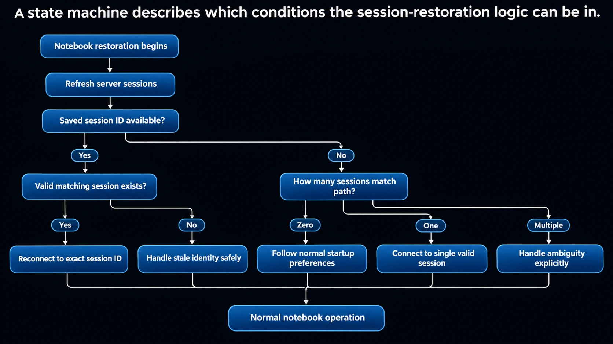

# JupyterLab Session Restoration: Problem, Prototype, Implementation, and Tests

A notebook should reconnect to the kernel it was using before a reload. This project investigates what happens when several server sessions share the same notebook path, demonstrates the problem with real kernels, and implements a preference-based reconnection change in JupyterLab.

The measured implementation selects the session on the notebook's path that runs the preferred kernel. **It does not remove duplicate sessions or prevent every duplicate-session workflow.**

## Project references

| Item | Reference |
| --- | --- |
| Reported issue | [JupyterLab #20372](https://github.com/jupyterlab/jupyterlab/issues/20372) |
| Related session-reuse approach | [PR #20426](https://github.com/jupyterlab/jupyterlab/pull/20426) |
| Reconnection implementation | [PR #20429](https://github.com/jupyterlab/jupyterlab/pull/20429) |
| Implementation branch | [session-identity-affinity](https://github.com/Pradhyut21/jupyterlab/tree/session-identity-affinity) |
| Regression tests committed first | `3937ebf` |
| Measured fix commit | `bb36a0384a886a498bdfff099094c4da86483af3` |
| Runnable prototype notebook | [session_identity_demo.ipynb](https://github.com/Pradhyut21/jupyterlab/blob/main/machzero/jupyterlab-20372-demo/session_identity_demo.ipynb) |

This document describes the recorded revisions and local evidence. It does not imply that the pull request has been merged or that every upstream CI workflow has passed.

## Contents

- [1. The problem](#1-the-problem)
- [2. Terms and root cause](#2-terms-and-root-cause)
- [3. Prototype and implementation](#3-prototype-and-implementation)
- [4. Architecture and state machine](#4-architecture-and-state-machine)
- [5. Code changes](#5-code-changes)
- [6. Run the notebook prototype](#6-run-the-notebook-prototype)
- [7. Test cases](#7-test-cases)
- [8. Measured comparison](#8-measured-comparison)
- [9. Run the implementation tests](#9-run-the-implementation-tests)
- [10. Browser verification](#10-browser-verification)
- [11. Windows setup and checks](#11-windows-setup-and-checks)
- [12. Files and evidence](#12-files-and-evidence)
- [13. Limitations and next work](#13-limitations-and-next-work)

## 1. The problem

Consider a notebook named `analysis.ipynb` with two server sessions:

| Session | Notebook path | Kernel | Role |
| --- | --- | --- | --- |
| A | `analysis.ipynb` | Kernel A | Older session |
| B | `analysis.ipynb` | Kernel B | Session currently used by the notebook |

The notebook runs code in Kernel B. After a reload, the older path-only lookup can reconnect it to Session A. A subsequent Restart Kernel action then targets Kernel A, while the code originally started in Kernel B can keep running.

The important failure is the loss of identity across restoration: the path is correct, but the selected session and kernel are different.

One reproduction sequence is:

1. Open a notebook normally, then close its tab while leaving its kernel running.
2. Open the same file with **Open With → Notebook (no kernel)**.
3. Select a kernel and run a long-running cell.
4. Reload the page.
5. Restart the notebook's connected kernel.
6. Observe whether the original long-running code actually stopped.

The prototype reproduces this sequence through modeled frontend operations against a real Jupyter Server. Direct browser verification of the implementation is a separate step.

## 2. Terms and root cause

| Term | Meaning |
| --- | --- |
| Notebook path | The document's location, such as `analysis.ipynb` |
| Session ID | The identifier of a server session linking a document to a kernel |
| Kernel ID | The identifier of a running computation kernel |
| Kernel name | A kernel specification name, such as `python3` or `ipython` |
| Restoration arguments | Saved arguments used to reopen a notebook after a reload |

**Session IDs and kernel IDs are different identifiers.** The implementation stores a kernel ID as a preference, then looks for a session on the notebook's path that runs that kernel.

The older selection behavior can be summarized as:

```text
Refresh running sessions
    → Find the first session whose path matches the notebook
    → Connect to that session
```

The revised selection behavior is:

```text
Refresh running sessions
    → Collect sessions whose path matches the notebook
    → Prefer a session whose kernel ID matches the saved preference
    → Otherwise keep the original first-session fallback
```

Duplicate sessions arise in the demonstrated workflow because the frontend starts a session under a temporary path and then renames it to the notebook path. The prototype models that sequence rather than assuming that a direct session-creation request for an already-used path will create another session.

## 3. Prototype and implementation

There are two separate working artifacts.

### Runnable proof of concept

Local notebook:

```text
D:\machzero\jupyterlab-20372-demo\session_identity_demo.ipynb
```

The notebook uses real Jupyter Server processes, REST requests, sessions, kernels, and a bounded heartbeat-writing loop. Its Python functions model the relevant frontend steps and compare baseline selection, the PR #20426 approach, and preferred-kernel restoration.

It is a **working proof of concept with real kernels and modeled frontend restoration**. It does not run the JupyterLab TypeScript frontend as part of those modeled steps.

### JupyterLab implementation

Local source checkout:

```text
D:\machzero\jupyterlab
```

The implementation exists on `session-identity-affinity`, measured at `bb36a03`. It changes the notebook restoration arguments and session selection, with regression tests in the apputils package.

The prototype's older statements that the proposal is “not implemented yet” describe its original stage. They are outdated relative to this branch. Running the prototype still exercises its Python model rather than substituting the implemented TypeScript code.

### Relationship to PR #20426

| Approach | Main concern | Observed scope |
| --- | --- | --- |
| PR #20426 | Reuse an existing path session when selecting a kernel after opening without one | Prevented a new duplicate in the first comparison scenario |
| This branch | Preserve a preferred kernel through notebook restoration | Selected the preferred kernel when duplicate path sessions already existed |

These approaches address related parts of the problem. This branch is not a claim that duplicate-session prevention is unnecessary or that the related PR failed its intended scenario.

## 4. Architecture and state machine

### Supplied state-machine design



The diagram provides a reference design for the decisions around restoration:

1. Begin restoration and refresh server sessions.
2. Check whether a saved session identity is available.
3. If available, determine whether the matching session is valid or stale.
4. Otherwise, distinguish zero, one, and multiple sessions on the path.
5. Resolve the branch and return to normal notebook operation.

The diagram's exact-session-ID and explicit-ambiguity branches describe a broader design than the measured patch. They should not be presented as completed features of `bb36a03`.

| Diagram concept | What the measured implementation does |
| --- | --- |
| Saved session identity | Saves a **kernel ID** in restoration arguments |
| Exact session reconnection | Searches same-path sessions for the preferred kernel ID |
| Stale identity | Uses the first same-path session when no preferred match exists; the startup path supplies a preferred kernel name when available |
| Zero path sessions | Continues through existing startup preferences |
| One path session | Uses that session when initialization permits reuse |
| Multiple path sessions | Prefers a kernel-ID match; otherwise uses the first session |
| Explicit ambiguity resolution | No new ambiguity dialog, resolver, or user-facing choice is implemented |

### Implemented data flow

```text
Notebook panel's current kernel ID
              |
              v
Notebook tracker / restoration arguments
    { path, factory, kernel: { id } }
              |
              v
Layout restoration → docmanager:open
              |
              v
SessionContext.kernelPreference.id
              |
              v
SessionManager refreshes running sessions
              |
              v
Filter by the notebook's own path
              |
              v
Prefer matching kernel ID → connectTo({ model })
              |
              v
If no match: retain the first-session fallback
```

The notebook tracker also saves restoration arguments when the kernel ID changes, keeping the remembered preference aligned with the notebook's current connection.

## 5. Code changes

Three files change between the measured baseline and fix: two source files and one regression-test file.

### A. Save the kernel ID with notebook restoration arguments

File: `packages/notebook-extension/src/index.ts`

The argument builder used by the notebook restorer includes the current kernel ID when there is one:

```typescript
args: panel => {
  const id = panel.sessionContext.session?.kernel?.id;
  return {
    path: panel.context.path,
    factory: FACTORY,
    ...(id ? { kernel: { id } } : {})
  };
},
```

This makes kernel identity available to `docmanager:open` during restoration. It does not store a server session ID.

### B. Save again when the kernel identity changes

In the same notebook extension:

```typescript
widget.sessionContext.kernelChanged.connect((_, { oldValue, newValue }) => {
  if (oldValue?.id !== newValue?.id) {
    void tracker.save(widget);
  }
}, widget);
```

The comparison of IDs avoids saving again merely because a signal arrives without an identity change.

### C. Prefer the same-path session running the requested kernel

File: `packages/apputils/src/sessioncontext.tsx`

```typescript
const pathSessions = Array.from(manager.running()).filter(
  item => item.path === this._path
);
const model =
  pathSessions.find(
    item => !!preference.id && item.kernel?.id === preference.id
  ) ?? pathSessions[0];
```

Filtering by path first prevents an existing session on another notebook's path from becoming the preferred path-session candidate. If several same-path sessions run the same preferred kernel, `find()` selects the first of those sessions. No unique-session guarantee is added.

This lookup remains inside the existing initialization gate:

```typescript
const shouldConnectToPathSession = preference.shouldReuse !== false;
```

A context initialized with `shouldReuse: false` therefore does not use this connection path during initialization.

### D. Retain a preferred kernel name during startup

A remembered kernel ID may no longer exist, for example after server shutdown. The startup path computes the preferred name and supplies it alongside the ID when available:

```typescript
const name = Private.getDefaultKernel({
  specs: this.specsManager.specs,
  sessions: this.sessionManager.running(),
  preference
});
let options: Partial<Kernel.IModel> | undefined;
if (preference.id) {
  options = name ? { id: preference.id, name } : { id: preference.id };
} else if (name) {
  options = { name };
}
```

This protects the kernel-type preference on that startup path. The restoration argument change itself saves only the kernel ID; it does not newly persist a kernel name.

### Complexity and compatibility

The lookup scans the running-session list and retains the same-path candidates. For `n` running sessions and `k` same-path sessions, the selection takes O(n + k) time and O(k) extra memory.

No new public preference field or server endpoint is introduced. Behavior changes when a valid preferred kernel can be found among same-path sessions. The first-session fallback and the initialization reuse gate remain.

## 6. Run the notebook prototype

### Use the existing local environment

In PowerShell:

```powershell
Set-Location -LiteralPath 'D:\machzero\jupyterlab-20372-demo'
$env:PYTHONNOUSERSITE = '1'
& '.\.venv\Scripts\python.exe' -m jupyterlab
```

In the browser:

1. Open `session_identity_demo.ipynb`.
2. Select **Python 3 (ipykernel)**.
3. Choose **Run → Run All Cells**.
4. Read the per-scenario tables and the final summary.
5. Let the final cleanup cell complete.

Run from the demo folder: the notebook resolves its scratch directory from the current working directory. It recreates `demo-run/`, so keep personal files out of that folder and avoid overlapping notebook runs.

### Run without the browser

```powershell
Set-Location -LiteralPath 'D:\machzero\jupyterlab-20372-demo'
$env:PYTHONNOUSERSITE = '1'
& '.\.venv\Scripts\python.exe' -m nbconvert `
  --to notebook --execute --inplace session_identity_demo.ipynb `
  --ExecutePreprocessor.timeout=900
& '.\.venv\Scripts\python.exe' '.\tools\show_outputs.py'
```

This updates the notebook's saved outputs. Each run starts its own private server; the cleanup cell shuts down the sessions/kernels managed by that server and stops it. If an earlier cell fails, inspect `demo-run/server.log` and finish cleanup for that demo instance before starting another run.

### Prepare a fresh environment on another machine

From a downloaded or cloned copy of the demo folder:

```powershell
python -m venv .venv
& '.\.venv\Scripts\python.exe' -m pip install `
  'jupyterlab==4.6.5' nbconvert nbformat requests
$env:PYTHONNOUSERSITE = '1'
& '.\.venv\Scripts\python.exe' -m jupyterlab
```

The recorded prototype environment used Python 3.13.5, Jupyter Server 2.21.1, and JupyterLab 4.6.5. Pinning the JupyterLab package preserves the original demonstration target; this setup command does not pin every transitive dependency.

The existing local environment was created with `uv` and does not include `pip`. If a package needs to be added there, use its environment explicitly:

```powershell
uv pip install --python '.\.venv\Scripts\python.exe' PACKAGE_NAME
```

Replace `PACKAGE_NAME` with the dependency actually needed. Creating a fresh environment is separate from running the already-configured one.

## 7. Test cases

### A. Committed TypeScript regression tests

File: `packages/apputils/test/sessioncontext.spec.ts`

| Test | Setup | Expected assertion |
| --- | --- | --- |
| Preferred same-path kernel | Start one session, start another under a different path, then move it to the same path; request the second kernel ID | `sessionContext.session?.id` equals the second session's ID |
| Unavailable preferred kernel ID | Request a nonexistent kernel ID and the `ipython` name while the server default is another name | The started kernel is named `ipython` |

The first test explicitly checks that the server lists the two sessions in the expected order before initializing the context. The preferred session must therefore beat the older first candidate.

Essential assertions from the tests:

```typescript
sessionContext.kernelPreference = {
  ...sessionContext.kernelPreference,
  id: second.kernel!.id
};
await sessionContext.initialize();
expect(sessionContext.session?.id).toBe(second.id);
```

```typescript
sessionContext.kernelPreference = {
  id: UUID.uuid4(),
  name: 'ipython'
};
await sessionContext.initialize();
expect(specsManager.specs!.default).not.toBe('ipython');
expect(sessionContext.session?.kernel?.name).toBe('ipython');
```

Both tests failed on assertions against the recorded baseline and passed with the fix. The failures were incorrect selected session and incorrect fallback kernel name, rather than compilation or setup errors.

### B. TypeScript integration scenarios

The local comparison temporarily added `machzero-eval.spec.ts` to the apputils test directory. It used the actual `SessionContext` implementation and a real Jupyter Server. The evaluation file was removed after the comparison; it is not committed to the implementation branch.

| Scenario | Sequence | Success condition |
| --- | --- | --- |
| E1: no-kernel workflow | Create an existing session; initialize a no-kernel context; select a kernel; dispose that context; initialize a new context with the used kernel ID | The new context uses the kernel selected before the simulated reload |
| E2: two contexts | Connect two contexts to the same initial session; shut it down; let both contexts select kernels; recreate the second context with its previous kernel ID | The recreated context selects its own previous kernel rather than the first context's kernel |

These are reload simulations through new contexts sharing a `SessionManager`. They do not open two browser windows, exercise layout persistence, or prove the full browser interaction end to end.

### C. Notebook proof-of-concept scenarios

The notebook contains six scenario groups:

1. **Baseline reproduction:** modeled reload changes kernel; restarting the selected kernel leaves the original heartbeat loop running.
2. **PR #20426 workflow:** reuse the path session; reload keeps the selected kernel; restart stops the loop.
3. **Existing duplicates with the older reload lookup:** reload selects the older session and the original loop continues.
4. **Preferred-kernel proposal:** remember the active kernel, reconnect to it, and stop its loop through restart.
5. **Fallbacks:** a gone remembered kernel or an ID belonging to another notebook does not replace the own-path fallback selection.
6. **Shared-session side effect:** changing the existing session's kernel can stop code used by another modeled tab. This is documented behavior to discuss, not presented as a newly established defect in the related PR.

The saved notebook summary includes these results:

| Modeled behavior | Scenario | Sessions on path | Same kernel after modeled reload | Restart stopped loop |
| --- | --- | --- | --- | --- |
| Baseline | Original issue sequence | 2 | No | No |
| PR #20426 approach | Original issue sequence | 1 | Yes | Yes |
| PR #20426 approach | Duplicates already exist | 2 | No | No |
| Preferred-kernel proposal | Duplicates already exist | 2 | Yes | Yes |

These are saved prototype outputs, separate from the TypeScript comparison below. The latest documentation inspection validated the notebook structure and Python syntax and found no saved error outputs; it did not execute the notebook again.

## 8. Measured comparison

The TypeScript comparison completed locally on **8 November 2026 at 00:31:26 India Standard Time (UTC+05:30)**. Each variant was rebuilt before its tests ran.

| Check | Baseline | PR #20426 | This branch |
| --- | --- | --- | --- |
| Two common kernel-preference regressions | 0/2 passed | 0/2 passed | 2/2 passed |
| E1: simulated reload retains selected kernel | Fail | Pass | Pass |
| E2: simulated reload retains its own kernel | Fail | Fail | Pass |
| Sessions after E1 | 2 | 1 | 2 |
| Sessions after E2 | 2 | 2 | 2 |
| Apputils test build | Pass | Pass | Pass |

PR #20426 also ran its own existing-path kernel-change test, which passed. That additional test is separate from the two common regressions.

Recorded suite summaries:

```text
Baseline regression selection: 2 failed, 50 skipped, 52 total
PR #20426 regression selection: 2 failed, 1 passed, 50 skipped, 53 total
This branch regression selection: 2 passed, 50 skipped, 52 total

Baseline integration scenarios: 2 failed
PR #20426 integration scenarios: 1 passed, 1 failed
This branch integration scenarios: 2 passed
```

A separate recorded run of the complete `sessioncontext.spec.ts` suite passed **52/52 tests** with the fix. That full-suite result is distinct from the filtered three-version comparison.

### Exact revisions

| Variant | Revision |
| --- | --- |
| Upstream baseline source | `1c917ab158ef862c86630291ecd0771f0b6de8ba` |
| Baseline plus the new tests | `3937ebf` |
| Related PR source | `d75a1fdbd61a4bc2c2ab610f460ff3e95c46eb2a` |
| Related PR plus the same new tests | `1451fc0291d698e17c5766653e575a3a56704046` |
| This branch | `bb36a0384a886a498bdfff099094c4da86483af3` |

These are pinned comparison revisions, not a claim about the current contents of upstream `main` or a later PR revision. The prototype's modeled baseline uses an older 4.6.x source reference and must not be confused with this table.

## 9. Run the implementation tests

Use the existing prepared checkout and environment. `jlpm` is the repository's package-manager wrapper.

```powershell
. 'D:\machzero\scripts\jl-env.ps1'
Set-Location -LiteralPath 'D:\machzero\jupyterlab'
git branch --show-current
git rev-parse HEAD
git status --short
```

Confirm the intended branch and revision before interpreting results. Do not switch a checkout being used by another test or comparison process.

### Rebuild and run the regression tests

```powershell
Set-Location -LiteralPath 'D:\machzero\jupyterlab\packages\apputils'
jlpm build:test
jlpm test test/sessioncontext.spec.ts -t 'preferred kernel'
```

### Run the complete session-context suite

```powershell
Set-Location -LiteralPath 'D:\machzero\jupyterlab\packages\apputils'
jlpm build:test
jlpm test test/sessioncontext.spec.ts
```

Jest loads compiled package code. Rebuild after source edits so the tests do not exercise stale output.

The recorded comparison raised the session-context server-start timeout to 180 seconds locally because startup was slow on this machine. This temporary adjustment was removed afterward. If an unchanged local run fails in server startup, distinguish that setup timeout from a behavioral assertion failure.

### Run the additional TypeScript lint configuration

From the source checkout root:

```powershell
jlpm eslint:base --config eslint.config.typecheck.mjs `
  packages/apputils/src/sessioncontext.tsx `
  packages/apputils/test/sessioncontext.spec.ts `
  packages/notebook-extension/src/index.ts
```

The recorded check exited successfully with zero errors and 24 warnings on unchanged lines. All applicable local pre-push hooks, including Prettier, ESLint, and integrity, passed before the branch was pushed. Local validation is separate from upstream CI.

### About the local comparison driver

```text
D:\machzero\scripts\compare-variants.ps1
```

This is a machine-specific experiment driver, not a portable test command. It switches revisions, prepares a temporary branch, cherry-picks the test commit, installs a temporary evaluation file, and restores the implementation branch after its normal run. It assumes specific local paths and references and has no guaranteed recovery for every interruption.

Prefer the single-branch commands above for routine validation. Use the comparison driver only in a clean, disposable checkout after inspecting its assumptions. Do not run it alongside a push, browser development server, or another operation using the same checkout.

## 10. Browser verification

Direct browser validation remains the next verification step. The notebook model, TypeScript integration simulations, and explanatory video do not substitute for it.

Use a development build of the implementation checkout. An unchanged installed JupyterLab 4.6.5 package is suitable for reproducing the earlier behavior, but does not contain this branch's frontend changes.

For an already-configured source environment, the relevant sequence is:

```powershell
. 'D:\machzero\scripts\jl-env.ps1'
Set-Location -LiteralPath 'D:\machzero\jupyterlab'
jlpm build
python -c 'import jupyterlab; print(jupyterlab.__file__)'
python -m jupyterlab --dev-mode `
  --ServerApp.root_dir='D:\machzero\jupyterlab-20372-demo'
```

Check that the Python module and frontend assets resolve to the intended checkout. If the environment is not installed for source development, follow the checkout's contributing instructions before using this launch sequence.

### Manual acceptance cases

| Case | What to verify |
| --- | --- |
| Original issue sequence | Reload retains the notebook's intended kernel; Restart Kernel stops the code it started |
| Existing duplicate sessions | A notebook using the later session reconnects to its preferred kernel |
| Two browser views | After shutdown and reselection, reloading a view reconnects as intended |
| Kernel changed before reload | The saved restoration preference updates to the new ID |
| Preferred kernel no longer running | Startup follows the expected kernel preference and fallback behavior |
| Ordinary single-session notebook | Normal open, reload, restart, and shutdown still work |

Record before/after kernel IDs and server-session models, rather than relying only on toolbar labels. The test loop writes a heartbeat timestamp; two unchanged samples after restart provide a stronger observation than the displayed process ID alone.

In `loop.ipynb`, the manual reproduction loop is bounded to ten minutes. The private loop constructed by `session_identity_demo.ipynb` is bounded to two minutes. They are different demo artifacts.

## 11. Windows setup and checks

### Symlink support

The local integrity hook needed to create file symlinks. With Developer Mode disabled, creation failed with `EPERM`.

Enable **Settings → System → For developers → Developer Mode**, then verify with a small file-symlink probe. On the recorded machine, enabling the setting resolved symlink creation without a restart.

The pre-push check should still run normally; bypassing hooks does not fix the environment.

### Missing build dependency

After symlink support was available, the integrity check exposed a missing `hatchling` command. The repository lists `hatchling>=1.21.1` as a build requirement. It was installed into the existing environment:

```powershell
uv pip install `
  --python 'D:\machzero\jupyterlab-20372-demo\.venv\Scripts\python.exe' `
  'hatchling>=1.21.1'
```

The environment script places that virtual environment on `PATH` for the hook.

### Line endings and temporary file locks

The local checkout also encountered CRLF formatting errors and a denied temporary-file rename. The changed files were normalized to the repository's LF format, and the checks were retried after inspecting file state. No source-code change was needed for those local formatting corrections.

## 12. Files and evidence

### Demo folder

```text
D:\machzero\jupyterlab-20372-demo\
├── session_identity_demo.ipynb   # Real-kernel proof of concept
├── loop.ipynb                    # Manual browser reproduction notebook
├── tools\
│   ├── build_notebooks.py        # Regenerate demo notebooks
│   └── show_outputs.py           # Display recorded notebook results
└── demo-run\                     # Recreated scratch area for a demo run
```

### Source files

```text
packages/apputils/src/sessioncontext.tsx
packages/apputils/test/sessioncontext.spec.ts
packages/notebook-extension/src/index.ts
```

### Recorded comparison evidence

```text
D:\machzero\tmp\compare\summary.txt
D:\machzero\tmp\compare\main-tests.log
D:\machzero\tmp\compare\main-eval.log
D:\machzero\tmp\compare\pr20426-tests.log
D:\machzero\tmp\compare\pr20426-eval.log
D:\machzero\tmp\compare\ours-tests.log
D:\machzero\tmp\compare\ours-eval.log
D:\machzero\tmp\green-full.log
```

Those paths describe this machine. For reviewers, share the notebook and attach selected logs or recordings through a repository or PR rather than assuming that another person can access the local drive.

## 13. Limitations and next work

- Duplicate sessions can still exist; both measured scenarios left two sessions on this branch.
- Kernel-ID preference chooses a matching same-path session. It does not promise exact server session-ID restoration in every case.
- If the preferred kernel has no same-path match, selection keeps the older first-session fallback.
- No explicit ambiguity UI or full zero/one/multiple-session state-machine implementation is added.
- The integration scenarios simulate reload through `SessionContext`; notebook-restorer persistence and browser interactions need direct verification.
- The notebook's saved successful outputs demonstrate its Python model, not a fresh browser run of the fix.
- Local lint and push-hook success do not establish upstream CI success, maintainer approval, or merge status.

The next work is to verify the actual development build in the browser, record the relevant reload/restart interactions, review the complete diff, and address maintainer feedback using the measured evidence above.
